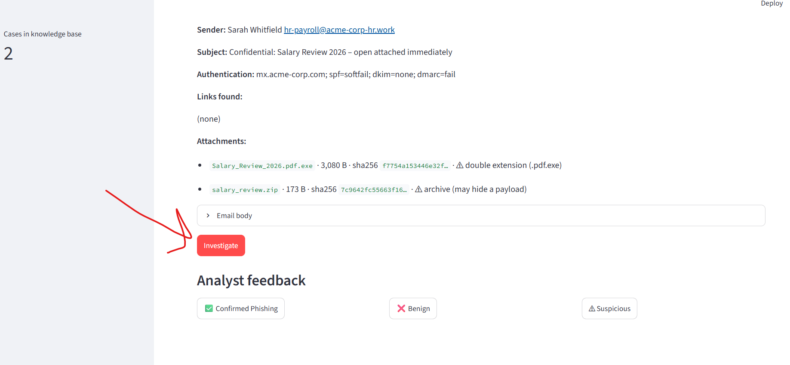

# AI-Powered Phishing Email Analyzer

A simple AI-powered phishing email analyzer that runs entirely on your computer.

Upload a .eml file and the AI uses a local LLM through Ollama to investigate the email, identify phishing indicators, and explain its findings. The application also uses a local RAG knowledge base to learn from previously analyzed emails.

## Features

- Upload and analyze .eml files
- AI-powered phishing investigation
- Local LLM integration with Ollama
- RAG-based knowledge retrieval using ChromaDB
- Detection of suspicious links, attachments, and email indicators
- User feedback system (Phishing, Suspicious, or Benign)
- Fully local and privacy-friendly

## Tech Stack

- Python
- Streamlit
- Ollama
- Llama 3.1
- ChromaDB
- Sentence Transformers

## Run Locally

- ollama should run first
- venv\Scripts\activate
- pip install -r requirements.txt
- streamlit run app.py

## Future Improvements

- IOC extraction
- MITRE ATT&CK mapping
- URL reputation checks
- PDF incident reports
- Outlook (.msg) support

## Screenshots

### File Upload

### Investigation Results

### AI Verdict

### Feedback and History

